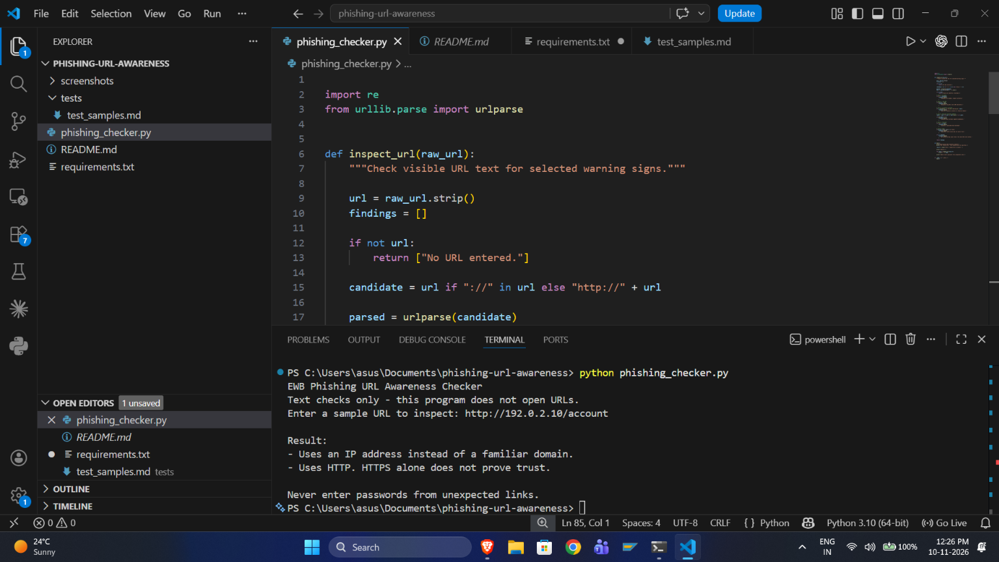
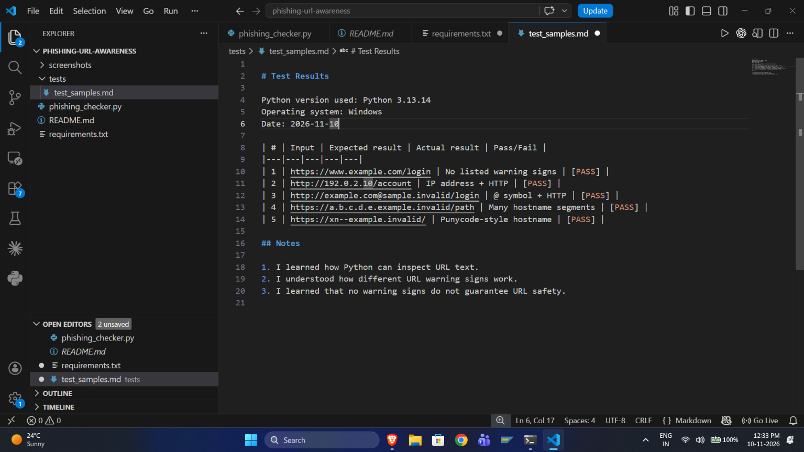

# EWB Phishing URL Awareness Checker

## Overview

Phishing is a cyberattack in which attackers use fake links or messages to steal sensitive information such as passwords, OTPs and payment details.

The EWB Phishing URL Awareness Checker is a Python-based educational tool that inspects URL text and identifies selected warning signs that may indicate a suspicious link.

The program does not visit websites or send data over the internet.

## Features

- Detects the `@` symbol in URLs.
- Flags unusually long URLs (over 100 characters).
- Detects IP-address hostnames.
- Identifies URLs with five or more hostname segments.
- Detects punycode-style hostnames (`xn--`).
- Flags HTTP connections instead of HTTPS.
- Supports checking multiple URLs without restarting.
- Displays a REVIEW CAREFULLY warning summary.
- Handles malformed URL input without crashing.
- Provides a quit option to exit the program.

## Technologies Used

- Python 3.10+
- Regular Expressions (re)
- urllib.parse
- Visual Studio Code
- GitHub

## Requirements

- Python 3.10 or later.
- No additional Python packages required.

## Project Structure

```text
phishing-url-awareness/
│
├── phishing_checker.py
├── README.md
├── requirements.txt
│
├── tests/
│   └── test_samples.md
│
└── screenshots/
    ├── sample_run.png
    └── test_results.png
```

## How to Run

1. Clone or download this repository.
2. Open the project folder in VS Code.
3. Open the terminal.
4. Run the following command:

```bash
python phishing_checker.py
```

5. Enter a sample URL when prompted.
6. Type `q`, `quit` or `exit` to close the program.

## Example Output

```text
EWB Phishing URL Awareness Checker
Text checks only - this program does not open URLs.

Enter a sample URL (or type q to quit):
http://192.0.2.10/account

Result:
- Uses an IP address instead of a familiar domain.
- Uses HTTP. HTTPS alone does not prove trust.

REVIEW CAREFULLY: 2 warning sign(s) found.

Never enter passwords from unexpected links.
```

## Testing

Five official sample test cases were executed.

| # | Test Case | Expected Result | Actual Result | Status |
|---|---|---|---|---|
| 1 | Normal HTTPS URL | No listed warnings | No listed warnings | PASS |
| 2 | IP address URL | IP + HTTP warnings | IP + HTTP warnings | PASS |
| 3 | URL with @ symbol | @ + HTTP warnings | @ + HTTP warnings | PASS |
| 4 | Multiple hostname segments | Hostname warning | Hostname warning | PASS |
| 5 | Punycode URL | Punycode warning | Punycode warning | PASS |

Detailed testing evidence is available in `tests/test_samples.md`.

## Screenshots

### Sample Program Execution



### Test Results



## Improvements

1. **Multiple URL Checking:** Added a continuous loop that allows users to inspect multiple URLs without restarting the program. Users can type q, quit or exit to close the program.

2. **Review Carefully Summary:** Added a warning summary that displays the total number of warning signs detected for a URL.

3. **Error Handling:** Added exception handling for malformed URL input to prevent the program from crashing.

## Limitations

- This tool only checks URL text.
- It does not visit websites.
- It does not scan for malware.
- It does not use online reputation services.
- It cannot guarantee that a URL is safe or malicious.

**No warning signs found does NOT mean a URL is safe.**

## Ethical Use

- Use this project for defensive cybersecurity learning only.
- Do not collect passwords or credentials.
- Do not use this tool to deceive anyone.
- Do not test websites without permission.
- Use only safe sample URLs for testing.

## Author

**Name:** AMAR KUMAR MUKHIYA  
**Course:** Cybersecurity Mini Project – EWB Courses
**Project:** EWB Cybersecurity Mini Project  
**Language:** Python


